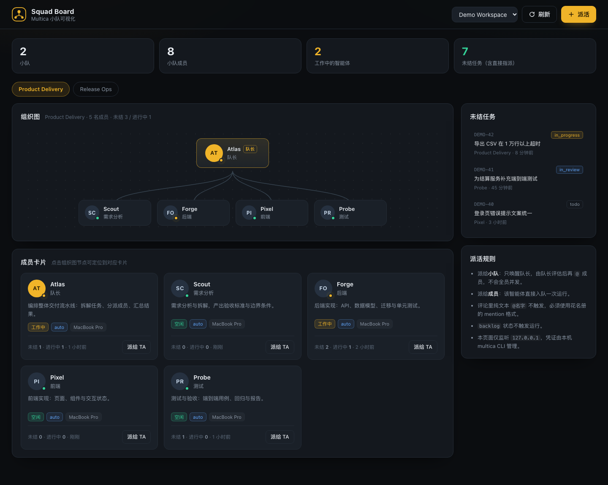

# Multica Squad Board

给 [Multica](https://github.com/multica-ai/multica) 小队做的本地可视化面板：**组织图 + 成员卡片 + 一键派活**。

零 npm 依赖、无需构建，所有数据都通过本机的 `multica` CLI 读写，凭证留在 `~/.multica`，服务只监听 `127.0.0.1`。



> 截图使用虚构示例数据。启动后访问 `http://127.0.0.1:4177/?demo=1` 即可用同样的示例数据预览界面，不会读取或修改你的 Multica。

## 功能

- **组织图**：队长居中在上，曲线连接每个成员，点击节点定位到成员卡片
- **成员卡片**：角色、描述、工作状态、模型、运行时、未结 / 进行中任务数、最近活跃时间
- **派活按钮**：创建 issue 并指派给小队或任意智能体，支持标题与描述
- **工作区切换**：多个 workspace 一键切换，选择记忆在本地
- **未结任务侧栏**：按更新时间列出任务与负责人，可跳回 Multica
- 每 60 秒自动刷新，手动刷新即时生效

## 前置要求

| 依赖 | 要求 |
| --- | --- |
| Node.js | 20 及以上 |
| multica CLI | 已安装并完成 `multica login`，`multica workspace list` 能列出工作区 |

Multica 官方云和自托管实例都可以，CLI 连的是哪个实例，面板展示的就是哪个实例。

## 一键安装

```bash
curl -fsSL https://raw.githubusercontent.com/wwwgang/multica-squad-board/main/install.sh | bash
```

脚本会检查环境、把仓库克隆到 `~/.multica-squad-board`，然后启动服务并自动打开浏览器。

### 让你的 Agent 帮你装

把下面这段直接发给你的 AI 编程助手（Claude Code / Cursor / Codex 等）即可：

```
帮我安装并启动 Multica Squad Board：
curl -fsSL https://raw.githubusercontent.com/wwwgang/multica-squad-board/main/install.sh | bash
如果 4177 端口被占用，用 PORT=4180 重新启动。
装好后告诉我访问地址。
```

### 手动安装

```bash
git clone https://github.com/wwwgang/multica-squad-board.git
cd multica-squad-board
node server.js
```

打开 http://127.0.0.1:4177 。

## 配置

| 环境变量 | 默认值 | 说明 |
| --- | --- | --- |
| `PORT` | `4177` | 监听端口，例如 `PORT=4180 node server.js` |
| `MULTICA_CLI` | `multica` | CLI 路径，多版本共存时可指定绝对路径 |
| `MSB_DIR` | `~/.multica-squad-board` | 一键安装时的克隆目录 |

停止服务：在终端按 `Ctrl+C`。再次启动：`cd ~/.multica-squad-board && node server.js`。

## 派活规则（和 Multica 一致）

- **派给小队**：只唤醒**队长**一次运行，由队长阅读上下文后用 `@` 分派给成员，**不会全员并发**
- **派给成员**：该智能体直接入队一次运行
- 任务处于 `backlog` 状态不会触发运行
- 标题和描述就是智能体拿到的全部任务上下文，建议写清验收标准、仓库与文档路径

## 安全说明

- 服务只绑定 `127.0.0.1`，不要改成 `0.0.0.0` 或暴露到公网：**派活接口没有鉴权**，能连到端口的人就能以你的身份创建任务
- 面板不读取、不复制你的 token，全部鉴权由 multica CLI 自己完成
- 修改工作区数据的操作只有「创建 issue」，其余接口均为只读

## 工作原理

```
浏览器  ──HTTP──>  本地 Node 服务（127.0.0.1:4177）  ──spawn──>  multica CLI  ──HTTPS/WS──>  你的 Multica 实例
```

- 读：`workspace list`、`squad list`、`squad member list`、`agent list`、`runtime list`、`issue list`
- 写：`issue create --assignee-id <小队或智能体> --description-stdin`

### 本地 API

| 接口 | 说明 |
| --- | --- |
| `GET /api/workspaces` | 工作区列表 |
| `GET /api/overview?workspace=<id>&refresh=1` | 小队、成员、智能体、运行时、未结任务聚合 |
| `POST /api/dispatch` | `{ workspaceId, title, description, assigneeId }` 创建并派活 |
| `GET /api/health` | 存活检查 |

##  License

MIT。与 Multica 官方无隶属关系，是一个社区小工具。
